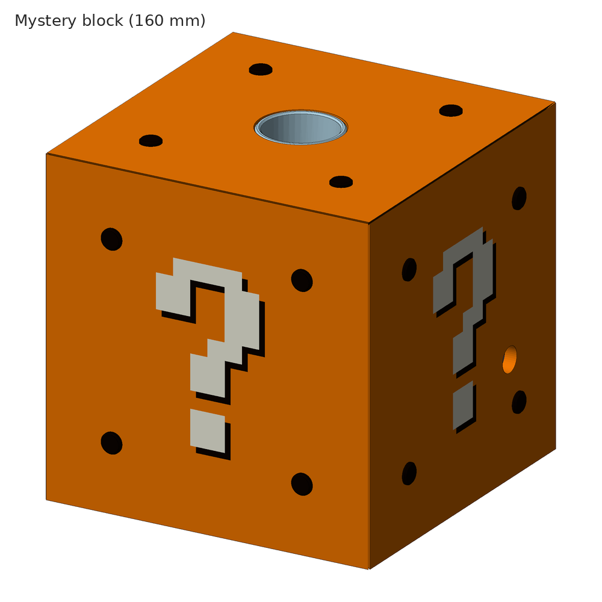
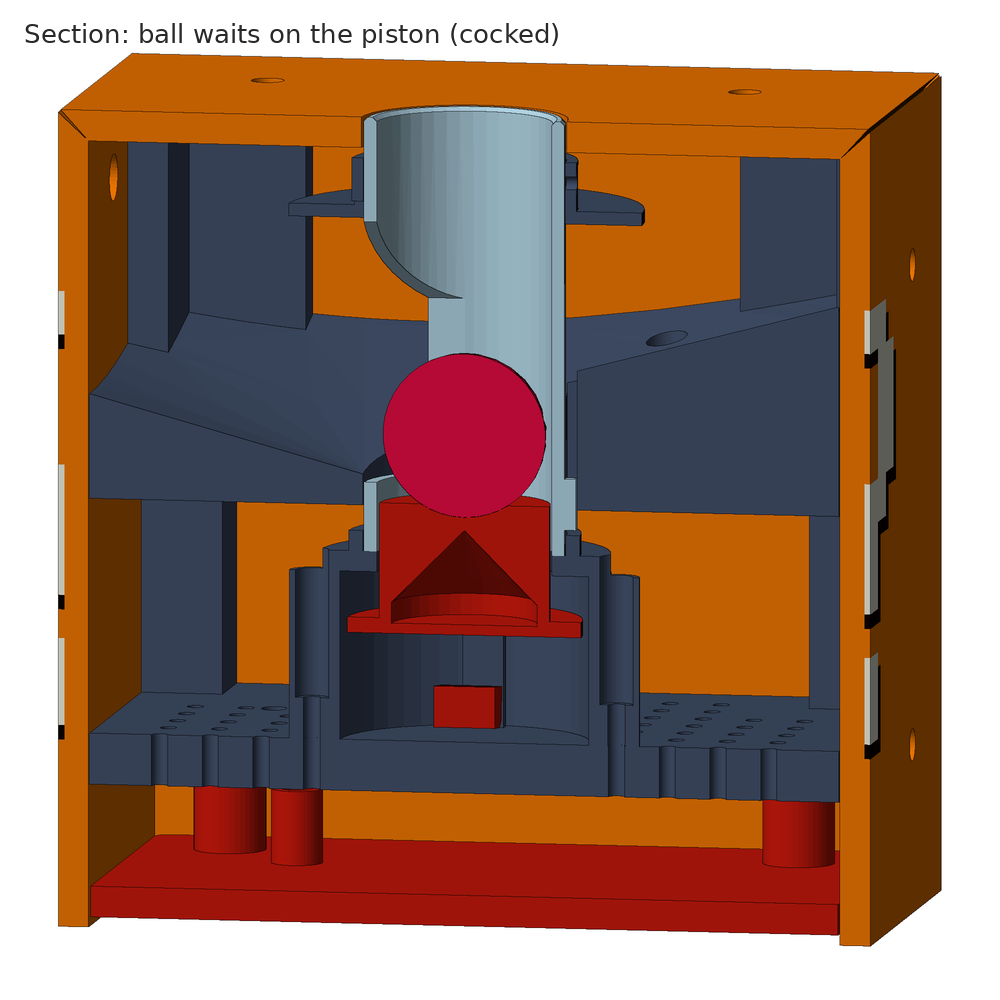
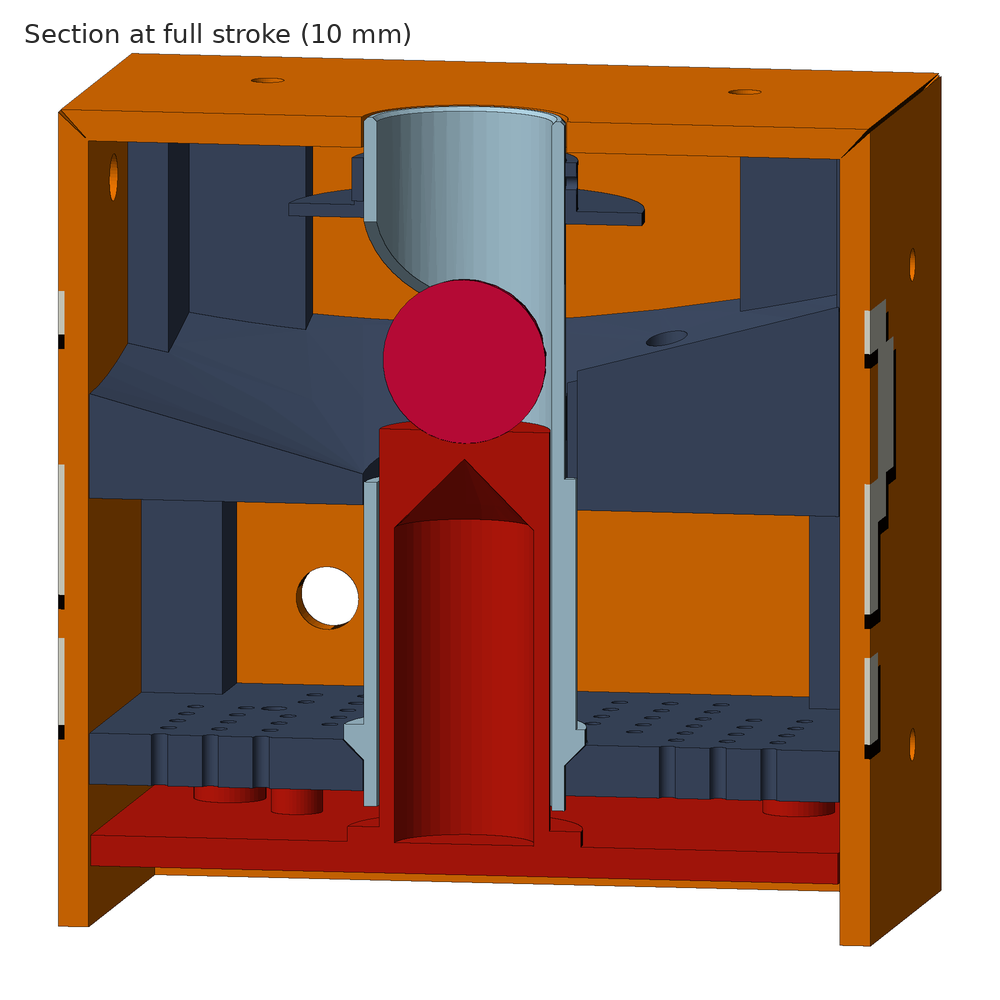

# Mystery Block 🟨❓

A 3D-printed, wall-mounted **"?" block that pops a candy capsule out of the top
when you bonk it from below**, with a coin chime and an LED flash.



> _Hero photo goes here once it's built: `images/photos/11-hero.jpg`_

* **No motors.** Your hit *is* the launcher: the bottom panel shoves a piston,
  the piston stops, the capsule keeps flying. Hit harder, it flies higher.
* **One capsule per bonk.** A sloped funnel feeds a one-ball chamber; the
  piston blocks the next ball until the panel drops back.
* **Sound + light** (optional): Hall sensor → Arduino Nano → DFPlayer chime +
  24-LED ring. The block still dispenses with the power off.
* **Printable on a Bambu A1 + AMS.** Multicolour faces printed face down, so
  colour swaps only happen on the first 1.2 mm.
* **Parametric CAD as code** (Python / build123d) with tests that prove the
  parts fit and the ball's path is clear.

| How it works | At full stroke |
|---|---|
|  |  |

## Build it

1. **Order parts:** [docs/bom.md](docs/bom.md) (~$90-120, all common stock).
2. **Print:** [docs/printing.md](docs/printing.md) (~1 kg PLA, ~40 h, AMS colour plan).
3. **Wire:** [docs/wiring.md](docs/wiring.md).
4. **Assemble:** [docs/assembly.md](docs/assembly.md) (~3 h).
5. **Flash:** [firmware/README.md](firmware/README.md) and copy `audio/sd/` to a microSD.

Fill it with **32 mm vending capsules** (put candy or a tiny figure inside) or
1" gumballs after changing one parameter.

## Repository layout

```
cad/            parametric model (params.py, model.py), exporter, renderer, tests
stl/  3mf/      ready-to-print parts (3mf = multicolour wall panels)
firmware/       Arduino Nano sketch + host unit tests
audio/          sound generator + ready-made microSD contents
docs/           architecture, BOM, printing, wiring, assembly, build log, blog draft
images/         renders (generated) and build photos (yours)
tools/          wiring-diagram generator
```

## Customise

Everything comes from [`cad/params.py`](cad/params.py):

```bash
pip install -r cad/requirements.txt
python cad/build.py      # regenerate STL / 3MF / renders
pytest cad               # fit, interference, ball-path and capacity checks
```

Block size, capsule size, stroke, floor slope, the pixel "?" and more are
one-line changes.

## Status

v1 design, not yet physically built. Follow along in the
[build log](docs/build-log.md), and see the
[architecture notes](docs/architecture.md) for why it works the way it does.

## Disclaimer & licence

A fan-made homage to the classic video-game "? block". All geometry, pixel art
and sounds here are original. Not affiliated with or endorsed by any game
company. Released under the [MIT licence](LICENSE).
