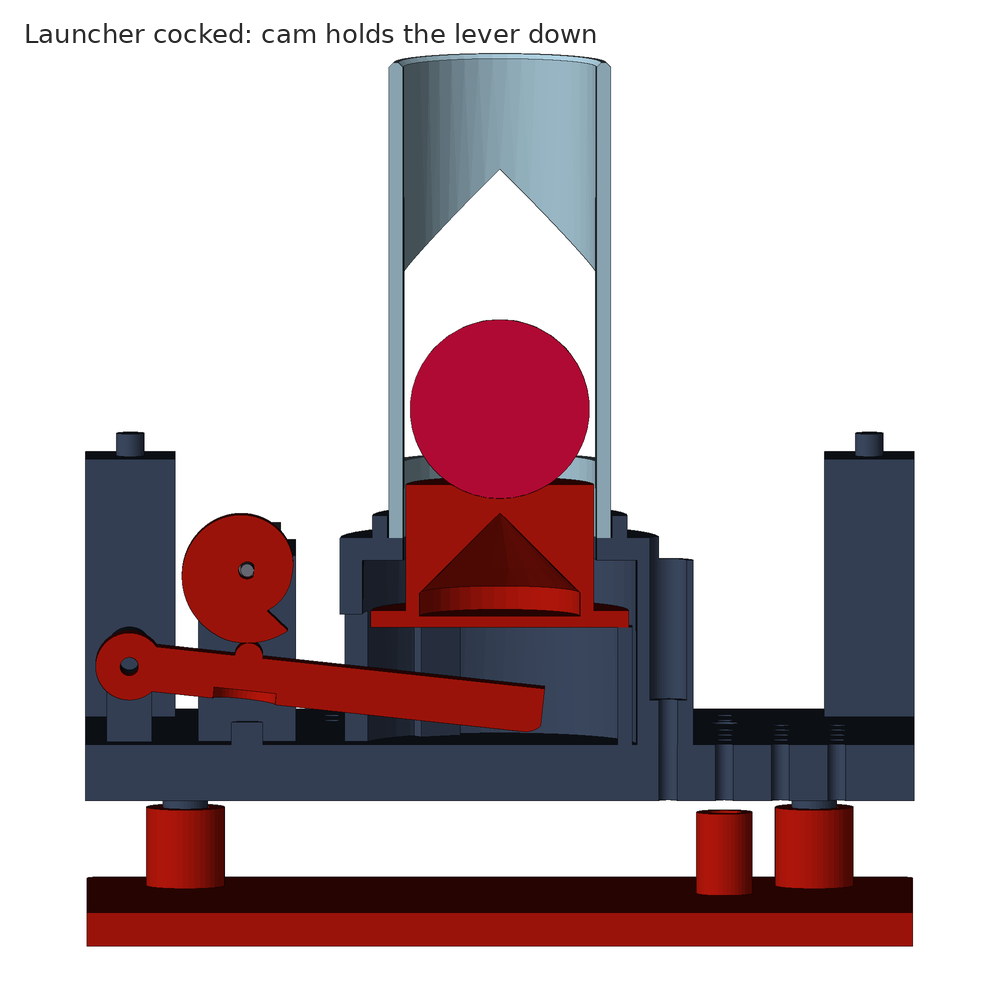
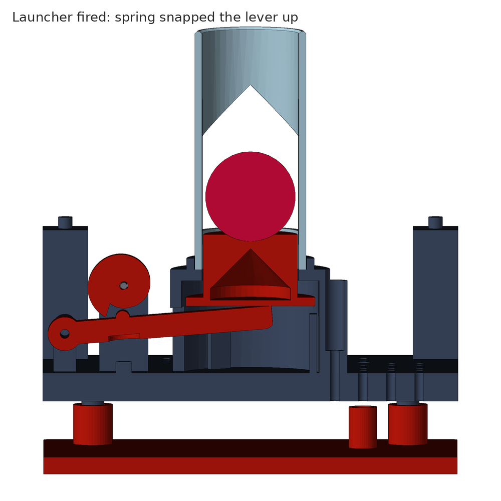
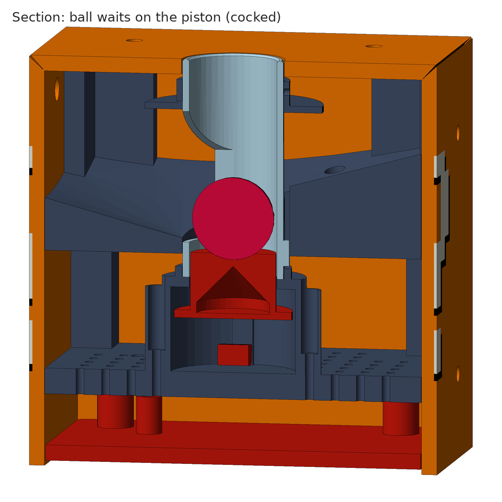
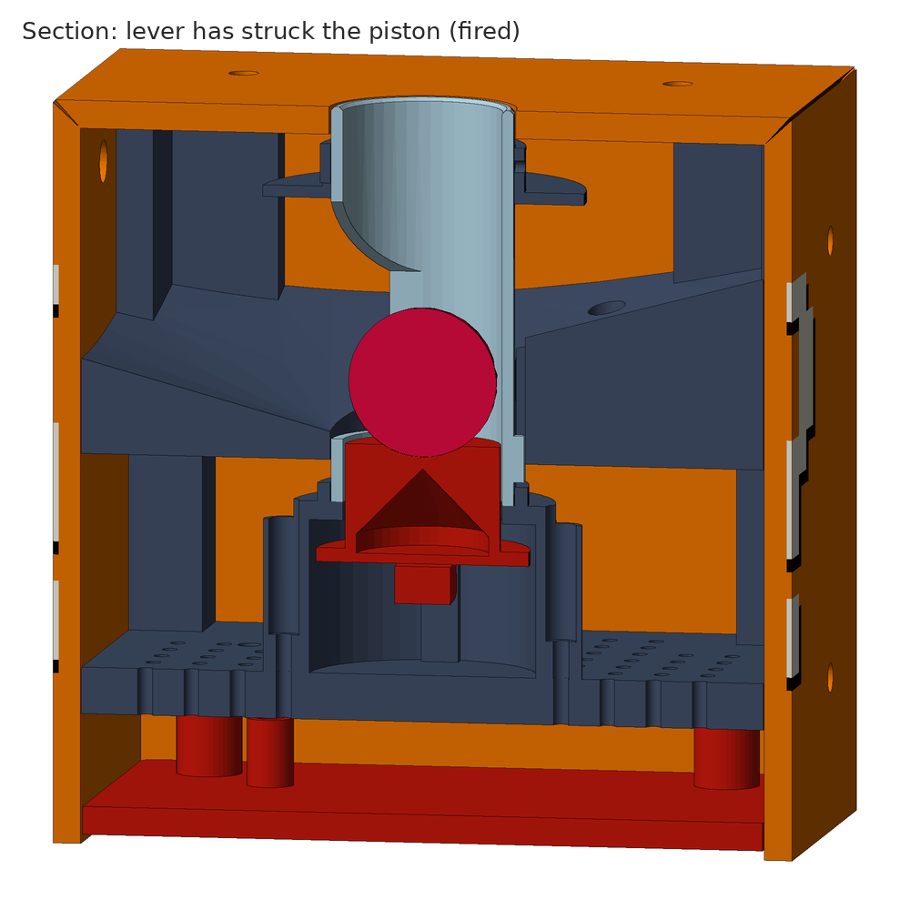

# Architecture: how the block launches a candy

## The requirement

Bonk the bottom of a "?" block, and a candy or a small figure pops out of the top.
It has to survive kids, be printable on a Bambu A1 (256 mm bed) with an AMS,
and be buildable by someone who is comfortable with microcontrollers but not
with mechanical design.

## Options considered

| # | Concept | Pros | Cons |
|---|---|---|---|
| **A** | **Direct mechanical launch.** The hit panel pushes a piston. The ball sits on the piston and keeps flying when the piston stops. Electronics only add sound + light | No actuator to size or tune. Instant response. Launch height follows how hard you hit (very "game"). Works with the power off | A very gentle tap won't launch (the ball rises and drops back, harmlessly) |
| B | Sensor + solenoid kicker under the ball | Same launch every time | A small 12 V push solenoid gives roughly 0.02-0.05 J, which is marginal for lifting a 5-8 g capsule 70 mm + flight. Needs 12 V, a MOSFET and a flyback diode. Loud *clack* |
| C | Sensor + servo cocks a spring plunger, then releases it | Strong, repeatable launch | Sear/latch mechanism is the hardest part to get right without iterations. Two moving mechanisms |
| D | Sensor + servo rotary dispenser + servo elevator | Gentle, "item rises out of the block" look | Servo speed can't throw anything. Item just sits on top. Two servos, more parts, slower |

## First decision: A (v1), then changed to C (v2)

v1 used option A: the hit panel *was* the launcher. It is the simplest possible
machine, but launch height follows the hit, so a gentle tap from a small kid
does nothing and a hard adult hit throws the capsule across the room. For a
toy that kids hit, **consistency matters more than simplicity**, so v2 switched
to a motor-cocked spring (a variant of C) with the hit panel as a sensor only.

C's weak spot was the latch ("sear"), which usually takes several print
iterations to tune. v2 avoids a latch entirely: a **snail cam** both cocks and
releases the spring, so there is nothing to trip and nothing to wear.

## How the launcher works

1. An **N20 gear motor** (≈ 50 RPM) turns a printed **snail cam**. Its radius
   grows slowly over 260° and then drops off a cliff.
2. The cam presses a **lever** down through a follower nose. The lever pivots
   on an M3 axle at the edge of the deck, and a **compression spring** under it
   is squeezed by 4 mm.
3. When the cam's cliff passes the nose, the spring snaps the lever up. Its tip
   (under the tower, at the centre) hits the bottom of the **piston** flange.
4. The piston jumps 3 mm, coasts 4 more and stops on bumpers under the **tower
   lip**. The capsule on top keeps going up the tube and out of the hatch.
5. The motor keeps turning, the cam picks the lever up again (re-cocks) and
   stops when a **magnet in the cam** reaches a second Hall sensor. The block now
   waits **cocked**, so the next hit fires in about 0.1 s.
6. While the piston is up, its side covers the hopper window, so only one
   capsule goes per launch. When it settles, the next capsule rolls in.

The spring energy is the same every time, so the pop height is the same every
time. It's tuned by swapping the spring (no reprinting).

**Why not a solenoid (B)?** It needs 12 V, its stroke is short, and the hobby
sizes are marginal for this mass. The cam + spring stores the energy slowly
from 5 V and releases it all at once.

**Safety and failure modes.** The motor can't drive the launch directly (the
spring does), so a jam can't break anything: the firmware stops the motor
after 3 s without the cam sensor and blinks red. Fingers can't reach the cam
with the walls on. Running backwards stalls harmlessly against the drop face.

## Key mechanisms

1. **Hit panel** (bottom, 147 mm square, 6 mm). Floats on four M4 screws with
   printed sleeves. It hangs on washers by gravity and travels **4 mm** up
   until its bosses hit O-ring bumpers under the deck. It's only a sensor now.
2. **Tower** is screwed to the deck. It holds the piston on three ribs, has a
   slot for the lever, a lip that stops the piston, and a collar for the tube.
3. **Piston** has a closed bottom (the lever hits it) and a shallow dish on top
   that centres the ball.
4. **Launch tube** (34.5 mm bore for 32 mm balls) stands on the tower and goes
   to the lid. A side **window** at the bottom lets one ball in from the hopper.
   Its roof is peaked at 45° so the tube prints without support.
5. **Hopper floor** is a funnel (cone) whose lowest point is at that window,
   sloped **15°** everywhere so balls always roll toward it. A diverter ridge
   behind the tube splits balls left/right so none park behind it.
6. **Chassis deck** carries the lever pivot, the spring post, the motor cradle,
   the cam sensor post, the speaker grille, the hit sensor pocket and a grid of
   M3 holes for mounting boards.
7. **Walls** are mitred panels (printed face down for perfect multicolour faces).
   The corner "rivets" are the screw heads, hidden under press-fit caps.
8. **Lid** sits on the mitres and is held by 4 magnet pairs. Lift it off to refill.

## Why capsules / round payloads

Anything round singulates perfectly: it rolls, it can't wedge, one fits the
chamber. Loose candy of random shapes is what makes real dispensers jam. 32 mm
vending capsules hold a wrapped candy or a small figure and keep the "mystery".
1" gumballs work too after one parameter change (`PAYLOAD_D = 25.4`).

## Hit sensing

A Hall sensor (SS49E) under the deck and a magnet in a post on the hit panel.
Contactless, so it can't be broken by hard hits (a microswitch would take the
full force of every hit). The analog reading lets
firmware set the threshold and auto-zero at boot. The magnet's polarity doesn't
matter (the firmware uses the absolute deviation). The cam position uses the
same trick: a second SS49E and a magnet in the cam, so there's no limit switch.

## Numbers (defaults)

| Quantity | Value |
|---|---|
| Block | 160 mm cube |
| Payload | 32 mm ball / capsule |
| Hopper capacity | ~19 capsules (computed in `pytest cad`) |
| Hit panel stroke | 4 mm (sensor only) |
| Piston | 3 mm kick + 4 mm coast |
| Spring | 4 mm compression, ≈ 2-5 N/mm |
| Launch speed | ~1.9 m/s (clears the top by ~10 cm) |
| Cycle | 1 cam turn ≈ 1.2-1.5 s, fires ≈ 0.1 s after the hit |
| Floor slope | 15° |
| Power | 5 V USB-C, < 1 A typical |
