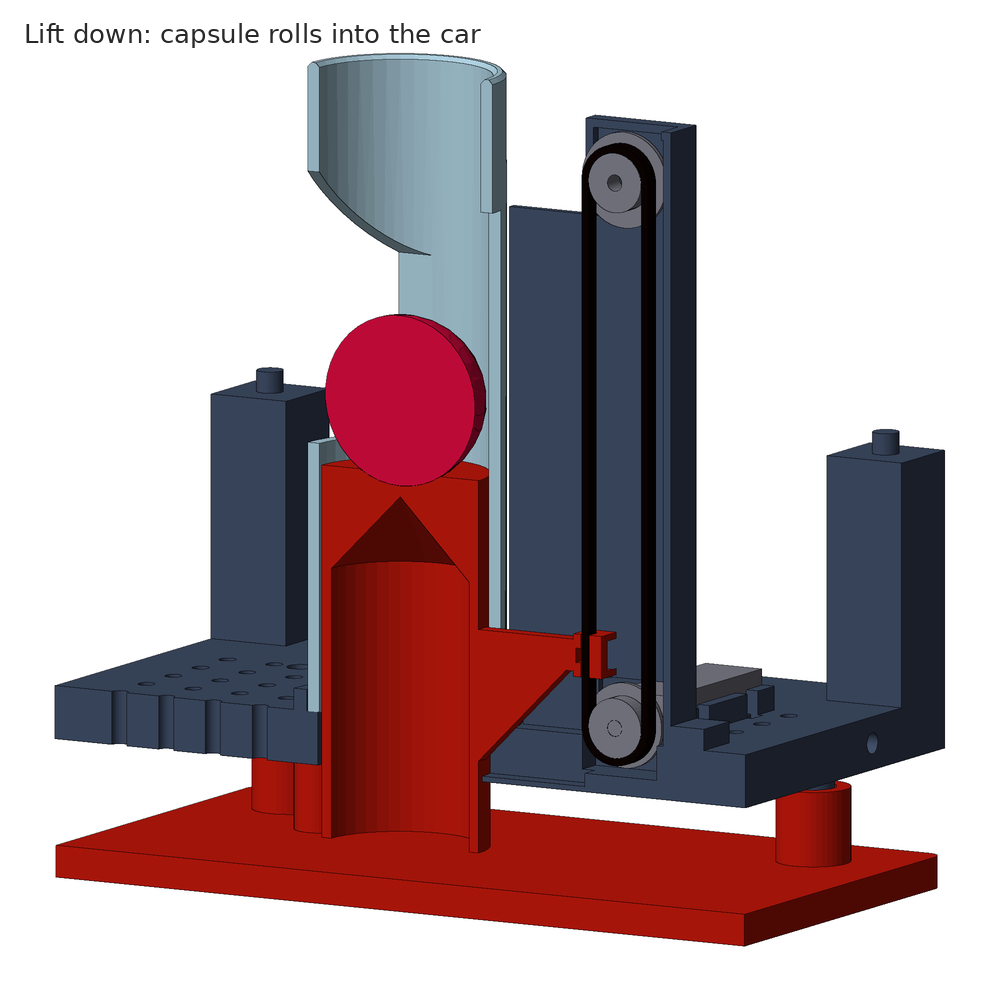
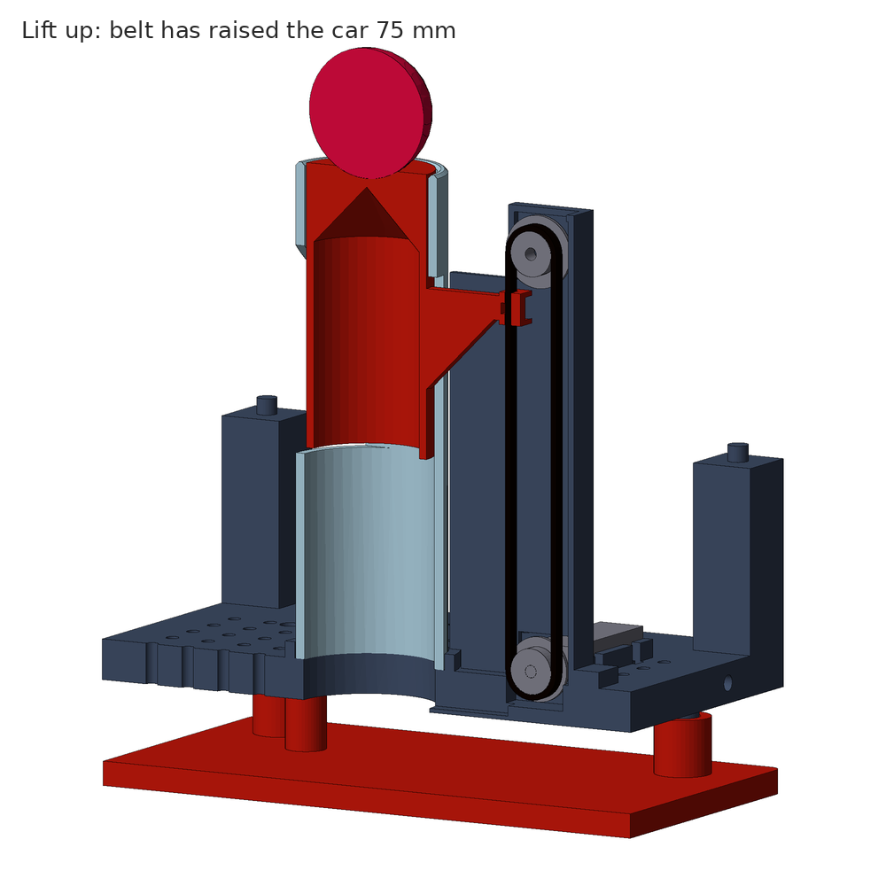
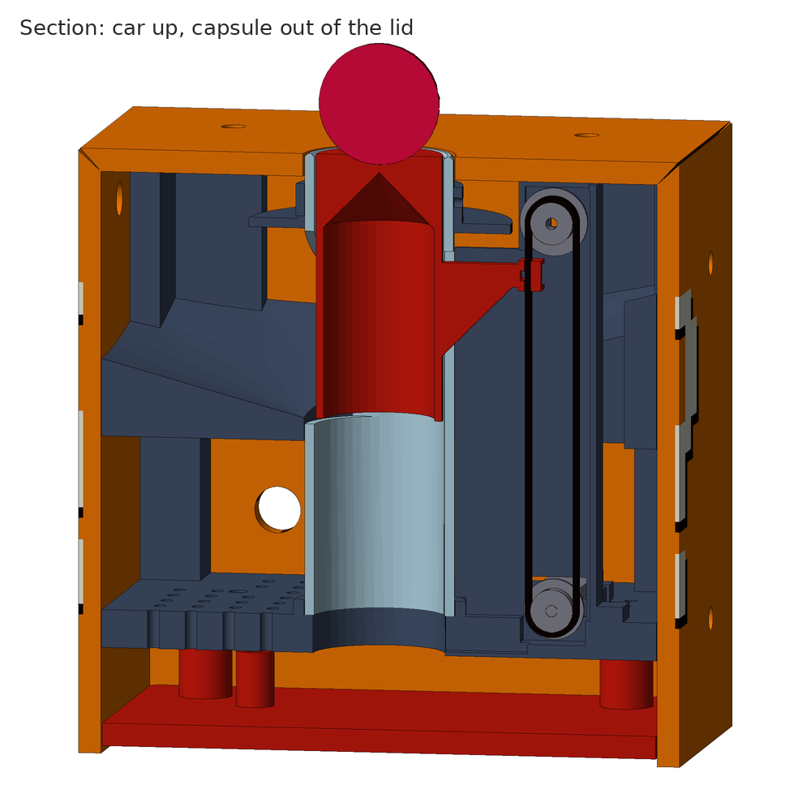

# Architecture: how the block delivers a candy

## The requirement

Bonk the bottom of a "?" block, and a candy or a small figure comes out of the top.
It has to survive kids, be printable on a Bambu A1 (256 mm bed) with an AMS,
and be buildable by someone who is comfortable with microcontrollers but not
with mechanical design.

## Options considered

| # | Concept | Pros | Cons |
|---|---|---|---|
| **A** | **Direct mechanical launch.** The hit panel pushes a piston. The ball sits on the piston and keeps flying when the piston stops. Electronics only add sound + light | No actuator to size or tune. Instant response. Launch height follows how hard you hit (very "game"). Works with the power off | A very gentle tap won't launch (the ball rises and drops back, harmlessly) |
| B | Sensor + solenoid kicker under the ball | Same launch every time | A small 12 V push solenoid gives roughly 0.02-0.05 J, which is marginal for lifting a 5-8 g capsule 70 mm + flight. Needs 12 V, a MOSFET and a flyback diode. Loud *clack* |
| C | Sensor + servo cocks a spring plunger, then releases it | Strong, repeatable launch | Sear/latch mechanism is the hardest part to get right without iterations. Two moving mechanisms |
| **D** | **Sensor + motor elevator** | Gentle, "item rises out of the block" look. Kid takes it at their own pace, nothing falls on the floor | Slower (a couple of seconds). A belt or rack to fit inside the box |
## Decisions: A (v1), then C (v2), then D (v3, current)

v1 used option A: the hit panel *was* the launcher. It is the simplest possible
machine, but launch height follows the hit, so a gentle tap from a small kid
does nothing and a hard adult hit throws the capsule across the room. For a
toy that kids hit, **consistency matters more than simplicity**, so v2 switched
to a motor-cocked spring (a variant of C) with the hit panel as a sensor only.

v2 still *threw* the capsule, so a kid had to catch it, or it fell back into
the tube (or bounced off the block onto the floor). v3 uses a **lift** (a
variant of D with one motor and no servos): the capsule rises out of the lid,
waits there to be taken, and goes back down if nobody takes it. That's calmer,
works for any kid, and drops nothing on the floor.

## How the lift works

1. A capsule rolls down the hopper floor through the tube's side **window** and
   settles in the dish on top of the **car**.
2. A hit starts the **N20 gear motor**. A GT2 pulley on its shaft drives a short
   **timing belt** loop that runs up the **belt housing** in front of the tube
   to an idler under the lid.
3. The car's **arm** comes out of a slot in the front of the tube and is clamped
   to the belt. The belt pulls the car 75 mm up (≈ 2.3 s at 50 RPM) until the
   capsule sits on top of the block, 90% of it above the lid.
4. A **magnet in the belt clamp** passes two Hall sensors on the housing. The
   top one stops the motor, it holds for 8 s, then runs down until the bottom
   one stops it.
5. **One at a time without a gate:** the car is 70 mm tall. As soon as it
   rises, its side wall covers the window, so the next capsule waits in the
   hopper. When the car is back down, the next one rolls in.
6. If nobody takes the capsule, it rides back down and is offered on the next hit.

**Why a belt and not a rack or a screw?** A rigid rack has to be as long as the
travel *below* the car, and there's no room for 75 mm of rack under it. A lead
screw is slow and needs a coupler and bearings. An open GT2 belt is cheap, quiet,
and its two ends clamp to the car, so the car can't slip.

**Safety and failure modes.** The N20 is weak (it stalls at a fingertip), it
moves the car at ~33 mm/s, and the firmware stops it if a move takes more than
5 s (a hand on the capsule, a jam, a missing sensor) and blinks red. The next
hit re-homes it. Power cut mid-move: on power-up it drives back down first.

## Key mechanisms

1. **Hit panel** (bottom, 147 mm square, 6 mm). Floats on four M4 screws with
   printed sleeves. It hangs on washers by gravity and travels **4 mm** up
   until its bosses hit O-ring bumpers under the deck. It's only a sensor.
2. **Lift car**: a hollow 70 mm tall cylinder with a dish on top that centres
   the capsule, and an arm to the belt clamp. When down it hangs through a hole
   in the deck, clear of the hit panel.
3. **Belt housing** keeps capsules away from the belt, carries the idler axle
   (slotted, to tension the belt) and the two lift sensors.
4. **Lift tube** (34.5 mm bore for 32 mm balls) stands in a socket on the deck
   and goes to the lid. A side **window** lets one ball in from the hopper, and
   a slot on the front side lets the car's arm through.
   The window roof is peaked at 45° so the tube prints without support.
5. **Hopper floor** is a funnel (cone) whose lowest point is at that window,
   sloped **15°** everywhere so balls always roll toward it. The belt housing
   comes up through the floor in front of the tube.
6. **Chassis deck** carries the tube socket, the motor cradle, the belt housing,
   the speaker grille, the hit sensor pocket and a grid of M3 holes for mounting
   boards.
7. **Walls** are mitred panels (printed face down for perfect multicolour faces).
   The corner "rivets" are the screw heads, hidden under press-fit caps.
8. **Lid** sits on the mitres and is held by 4 magnet pairs. Lift it off to refill.

## Why capsules / round payloads

Anything round singulates perfectly: it rolls, it can't wedge, one fits the
chamber. Loose candy of random shapes is what makes real dispensers jam. 32 mm
vending capsules hold a wrapped candy or a small figure and keep the "mystery".
1" gumballs work too after one parameter change (`PAYLOAD_D = 25.4`).

## Hit sensing

A Hall sensor (SS49E) under the deck and a magnet in a post on the hit panel.
Contactless, so it can't be broken by hard hits (a microswitch would take the
full force of every hit). The analog reading lets
firmware set the threshold and auto-zero at boot. The magnet's polarity doesn't
matter (the firmware uses the absolute deviation). The lift's end positions use
the same trick: two more SS49E sensors and one magnet in the belt clamp, so
there are no limit switches.

## Numbers (defaults)

| Quantity | Value |
|---|---|
| Block | 160 mm cube |
| Payload | 32 mm ball / capsule |
| Hopper capacity | ~19 capsules (computed in `pytest cad`) |
| Hit panel stroke | 4 mm (sensor only) |
| Lift travel | 75.5 mm, capsule ends 90% above the lid |
| Lift speed | ~33 mm/s with a 50 RPM motor (~2.3 s up), ~66 mm/s at 100 RPM |
| Hold on top | 8 s (`LIFT_HOLD_MS`), then it goes back down |
| Cycle | ~13 s at 50 RPM: up, hold, down, next capsule rolls in |
| Floor slope | 15° |
| Power | 5 V USB-C, < 1 A typical |
