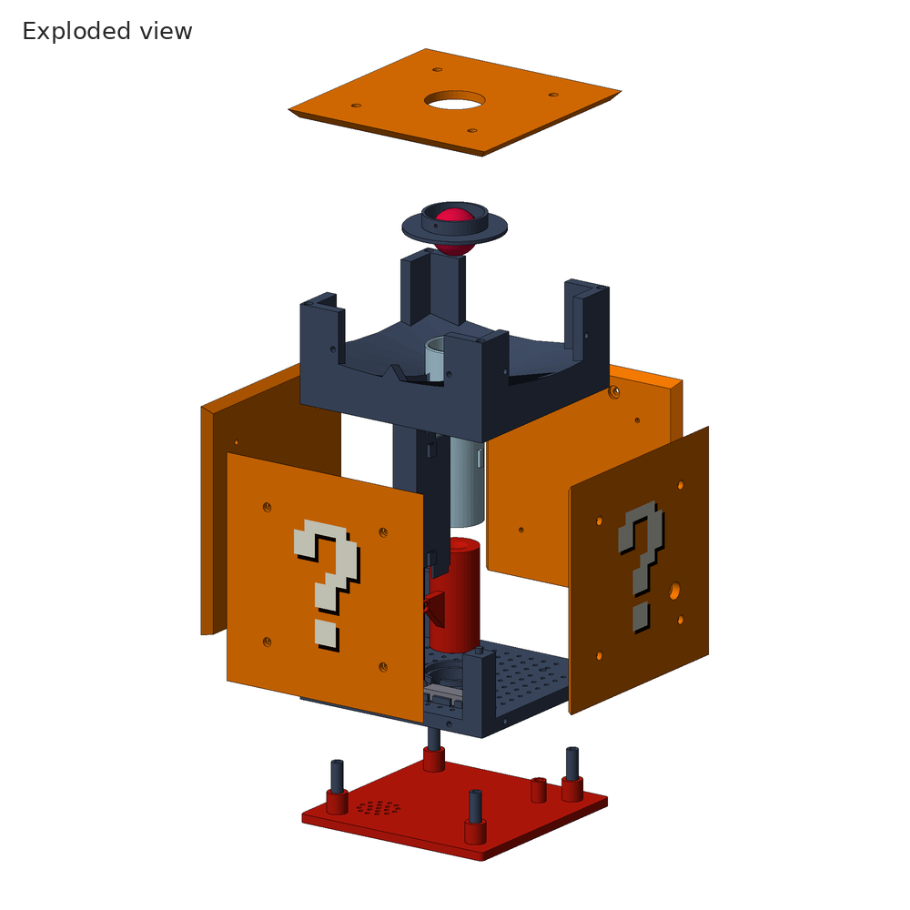
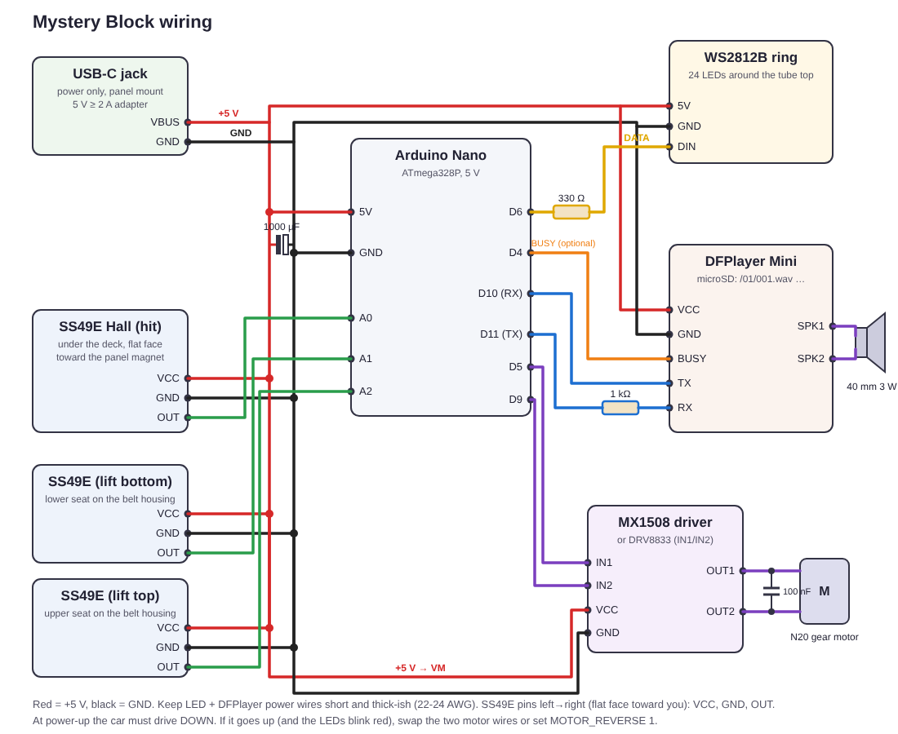
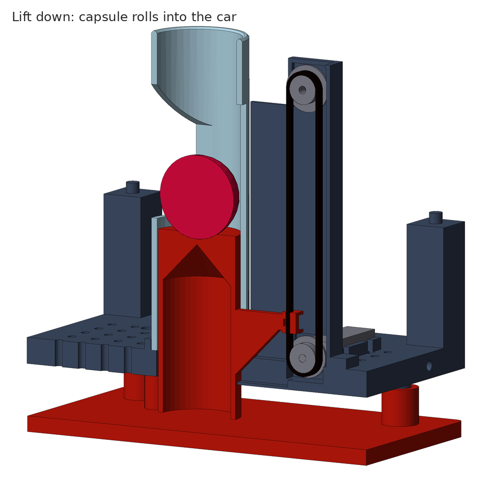

# Assembly guide

Time: ~3 hours once everything is printed. Read it through once first.

**Tools:** soldering iron with a heat-set tip (or a plain conical tip), 2 mm and
2.5 mm hex keys, CA glue, hot glue, small stubby screwdriver (for wall mounting).

> 📷 Blog: take a "flat lay" photo of all printed parts + hardware before you start.
> `images/photos/01-flat-lay.jpg`

---

## 1. Heat-set inserts (20 total)

| Where | Insert | Count |
|---|---|---:|
| Chassis deck, side edges (2 per side) | M3 | 8 |
| Hopper upper columns, outer faces (2 per side) | M3 | 8 |
| Chassis deck, **underside** at the four corners | M4 | 4 |

Iron at ~220 °C for PLA. Push gently and straight until the insert is flush,
then hold a flat object on it for a few seconds while it cools.

> 📷 `02-inserts.jpg`

## 2. Magnets (10 total)

1. Stack 8 magnets into one column so they all agree.
2. Press the bottom four, one at a time, into the **hopper column tops**. Mark
   the exposed face of each with a marker dot. Glue with a drop of CA.
3. For the **lid** pockets, take magnets from the *same end* of a fresh stack
   and check each one **attracts** a column magnet before gluing.
   (A wrong one is easy to notice: the lid will jump off.)
4. Glue 1 magnet in the post on the **hit panel** (polarity doesn't matter).
5. The last magnet goes in the lift car's belt clamp (step 4).

## 3. Electronics on the deck

Follow [wiring.md](wiring.md). Placement:

1. **Hall sensor**: lay the SS49E flat in the small pocket on the **underside**
   of the deck, branded face *down* (toward the hit panel), legs bent up through
   the hole next to it. A dab of hot glue.
2. **Speaker**: drop it into the round seat on top of the deck, **cone facing
   down** (it plays through the grille, out of the hit panel). Hot glue the rim.
3. **Perfboard** with the Nano and DFPlayer: anywhere on the M3 hole grid (M3
   standoffs, zip ties, or foam tape). Nano USB port toward an edge so you can
   reprogram it with the lid off.
4. Leave the **USB-C jack** and **LED ring** leads long. They connect later.

> 📷 `03-electronics-bay.jpg`

## 4. Lift

1. **Motor**: solder the 100 nF capacitor across its tabs and its two wires.
   Push the **GT2 pulley** onto the D-shaft (flat under a set screw) so the
   pulley sits centred on the slot in the deck in front of the tube socket.
   Lay the motor in the cradle, shaft toward the tube, and strap it with two
   zip ties through the slots.
2. **Lift sensors**: glue two SS49E sensors in the two seats on the right (+X) outside wall of the
   housing, branded face against the wall. The lower one is **bottom**, the
   upper one is **top**.
3. **Idler**: put the **M3×25** through the slot near the top of the housing
   and the idler (inside), nyloc nut outside. Leave it loose for now.
4. **Car**: glue a magnet into the pocket on the right face of the belt clamp
   (polarity doesn't matter). Drop the car into the tube socket from above, arm
   toward the front: it goes down through the hole in the deck until the arm's
   gusset rests in its slot.
5. **Housing**: lower it straight down over the car's arm and the pulley (the
   notch in its right wall clears the pulley hub, the gap at the top lets the
   belt clamp through), and fix it with two **M3×8** from under the deck.
6. **Tube**: slide it down over the car, slot to the front so the arm runs in
   it, window to the back, into the socket.
7. **Belt**: lift the car by hand to about half height. Run the belt from the
   clamp down around the pulley, up around the idler and back down to the
   clamp. Push both ends into the clamp's slot (one from above, one from below)
   and tighten the **M3×12** pinch screw. Pull the idler axle up in its slot
   until the belt is firm but not twanging, then tighten the nut.
8. Turn the pulley by hand: the car should run smoothly from the bottom (dish
   just below the window sill) to the top without touching the tube.
9. Bench test now, before the walls go on (see [wiring](wiring.md)): power up
   (the car drives down to the bottom), then send `f` in the Serial Monitor.
   The car rises, waits 8 s and comes back down. LEDs blinking red right after
   power-up = wrong direction: swap the motor wires or set `MOTOR_REVERSE 1`.

> 📷 `04-lift.jpg` · 🎥 `05-lift-test.mp4`

## 5. Hopper, LED ring

1. Lower the **hopper** over the tube and housing. The rib on the tube's right
   side slides into the slot, the housing goes through its cutout, and the four
   pegs on the posts drop into the holes underneath. It just rests there. The
   walls will clamp it.
2. Feed the LED-ring wires down the **wire hole** in the hopper floor (right
   side, toward the front).
3. Slide the **LED collar** onto the tube top, disc down, so its top is ~2 mm
   below the tube top. Snug the M3 set screw (or a wrap of tape). Hot glue the
   24-LED ring on the disc, LEDs **up**.

## 6. Hit panel

Do this with the core **upside down** (resting on the column tops).

1. Put an **O-ring** around each **sleeve**, and stand the sleeves on the four
   M4 inserts.
2. Lay the **hit panel** on top (bosses down over the sleeves; the O-rings sit
   between bosses and deck).
3. For each corner: M4 washer onto an **M4×30** screw, through the panel and
   sleeve, into the insert. Tighten until snug. The sleeve is the spacer, so
   you can't over-compress anything.
4. Turn the core upright. The panel should hang down 4 mm and **fall back
   freely** when you push it up. If it sticks, open the boss holes slightly with
   an 8.5 mm drill.

> 📷 `06-hit-panel.jpg` (bottom view)

## 7. Walls

1. Mount the **USB-C jack** in the **right** panel (the one with the round hole)
   and wire it to the perfboard (5 V + GND).
2. Hold each wall against the core and start all four **M3×8** screws by hand
   through the rivet holes before tightening any. Order: back, right, front, left.
3. The mitred corners should close with only a hairline V-groove.
4. Press the 16 **rivet caps** into the rivet holes.

> 📷 `07-walls-on.jpg`

## 8. Software

1. Copy the **contents** of [`audio/sd`](../audio/sd) to a FAT32 microSD card
   (you should see a folder `01` in the root). Insert it in the DFPlayer.
2. Flash [`firmware/mystery_block`](../firmware) (see [firmware/README](../firmware/README.md)).
3. Plug in USB-C. You should hear the start-up chime and see the ring shimmer.
4. The car drives down to its loading position (if it isn't there already).
5. Bonk the panel: coin sound + gold flash + the capsule rises out of the lid.
   Every 10th hit: bonus.
6. If hits are missed or false: set `DEBUG_HALL 1`, watch the Serial Monitor,
   and adjust `HIT_THRESHOLD` (see the firmware README).

## 9. Load it and test

1. Lift the lid off, pour in ~15-19 capsules, put the lid back on (magnets click).
2. Hold the block up (or rest its edges on two books so the bottom is free) and
   tap the bottom. A capsule should rise out of the top and wait there.
3. Don't take it: after 8 s it goes back down, and the next hit offers it again.

> 🎥 `08-first-lift.mp4`

## 10. Mounting

The bottom has to be hittable, so the block lives on a wall at head height.

1. Lift the lid off and empty the hopper.
2. Hold the block in place, mark the two holes in the **back** wall (56 mm apart,
   143 mm above the block's bottom edge).
3. Drill + anchors suitable for your wall (the load is a sideways shear, which
   screws in anchors handle well).
4. From inside (lid off), drive two #8 / 4 mm screws through the back wall into
   the anchors with a stubby screwdriver.
5. Run the USB-C cable down the wall from the right side.

> 📷 `09-mounted.jpg` · 🎥 `10-kids-reaction.mp4`

## Troubleshooting

| Symptom | Fix |
|---|---|
| Motor runs, car doesn't move | Pulley set screw not on the shaft flat, or belt loose in the clamp |
| Car stops short of the top / bottom | Sensor not seeing the magnet: check its seat, or lower `LIFT_ON_DELTA` (`DEBUG_LIFT 1` shows the readings) |
| LEDs blink red | Lift fault: motor backwards, jammed, or a lift sensor not seeing the magnet. The next hit retries. See the firmware README |
| Car moves on power-up | Normal: it always drives down to the bottom sensor first |
| Car squeaks / sticks | Belt too tight (loosen the idler a little) or a print blob in the tube slot |
| Two capsules come up | Shouldn't happen (the car covers the window). Check the car is the 70 mm tall v3 car |
| Panel sticks up | Sleeve holes too tight, or a guide screw not straight. Ream bosses to 8.5 mm |
| Balls stop feeding | Capsule seam catching? Rotate/sand. Check nothing (wire!) is on the hopper floor |
| No sound | SD card FAT32? Folder `01` at the root? Speaker on SPK1/SPK2 (not the DAC pins) |
| False hits | Raise `HIT_THRESHOLD`; check the Hall sensor is glued and not wobbling |
