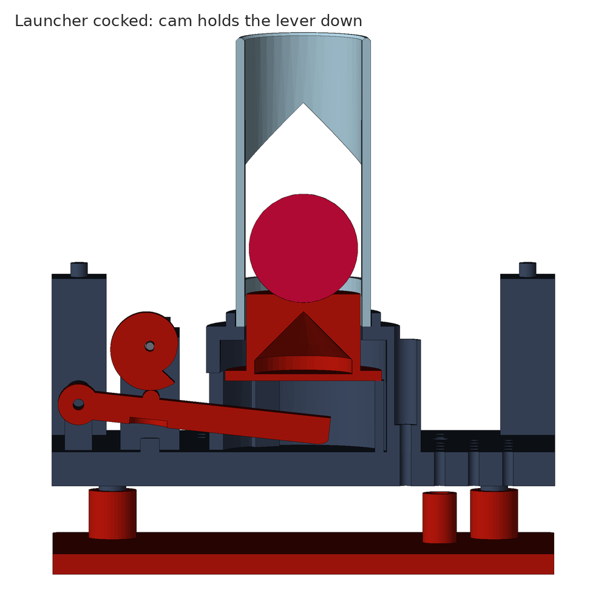

# Assembly guide

Time: ~3 hours once everything is printed. Read it through once first.

**Tools:** soldering iron with a heat-set tip (or a plain conical tip), 2 mm and
2.5 mm hex keys, CA glue, hot glue, small stubby screwdriver (for wall mounting).

> 📷 Blog: take a "flat lay" photo of all printed parts + hardware before you start.
> `images/photos/01-flat-lay.jpg`

---

## 1. Heat-set inserts (20 total)

| Where | Insert | Count |
|---|---|---:|
| Chassis deck, side edges (2 per side) | M3 | 8 |
| Hopper upper columns, outer faces (2 per side) | M3 | 8 |
| Chassis deck, **underside** at the four corners | M4 | 4 |

Iron at ~220 °C for PLA. Push gently and straight until the insert is flush,
then hold a flat object on it for a few seconds while it cools.

> 📷 `02-inserts.jpg`

## 2. Magnets (10 total)

1. Stack 8 magnets into one column so they all agree.
2. Press the bottom four, one at a time, into the **hopper column tops**. Mark
   the exposed face of each with a marker dot. Glue with a drop of CA.
3. For the **lid** pockets, take magnets from the *same end* of a fresh stack
   and check each one **attracts** a column magnet before gluing.
   (A wrong one is easy to notice: the lid will jump off.)
4. Glue 1 magnet in the post on the **hit panel** (polarity doesn't matter).
5. Glue 1 magnet in the pocket on the flat face of the **cam** (polarity doesn't matter).

## 3. Electronics on the deck

Follow [wiring.md](wiring.md). Placement:

1. **Hall sensor**: lay the SS49E flat in the small pocket on the **underside**
   of the deck, branded face *down* (toward the hit panel), legs bent up through
   the hole next to it. A dab of hot glue.
2. **Speaker**: drop it into the round seat on top of the deck, **cone facing
   down** (it plays through the grille, out of the hit panel). Hot glue the rim.
3. **Perfboard** with the Nano and DFPlayer: anywhere on the M3 hole grid (M3
   standoffs, zip ties, or foam tape). Nano USB port toward an edge so you can
   reprogram it with the lid off.
4. Leave the **USB-C jack** and **LED ring** leads long. They connect later.

> 📷 `03-electronics-bay.jpg`

## 4. Launcher

1. **Spring**: stand it on the short post on the deck between the pivot posts
   and the tower position.
2. **Lever**: set it between the two pivot posts, spring cup down over the
   spring, follower nose up. Push the **M3×30** axle through posts and lever and
   add a nyloc nut. Snug only: the lever must swing freely.
3. **Piston**: stand it on the three seat ribs in the middle of the deck,
   flange down. The lever tip goes under it.
4. Stick 3 **bumper dots** on the top of the piston flange (evenly spaced, tight
   to the body) and 1 on the top of the lever where it passes under the tower
   slot roof (≈ 42 mm from the axle).
5. **Tower**: lower it straight down over the piston, slot toward the lever.
   The piston comes up through the lip. Fix with three **M3×20** screws from the
   top and nyloc nuts under the deck.
6. **Motor**: solder the 100 nF capacitor across its tabs and its two wires,
   then lay it in the cradle, shaft toward the front (toward the lever), and
   strap it with two zip ties through the slots.
7. **Cam**: push it onto the D-shaft, magnet face toward the front. Turn it by
   hand (with the motor's own shaft, slowly) and check that it pushes the lever
   down, then lets it snap up at the cliff.
8. **Cam sensor**: glue the second SS49E in the seat on the small post in front
   of the cam, branded face toward the cam.
9. Bench test now, before the walls go on (see [wiring](wiring.md)): power up,
   send `f` in the Serial Monitor. The piston should pop and the cam should stop
   cocked. LEDs blinking red = wrong direction, swap the motor wires.

> 📷 `04-launcher.jpg` · 🎥 `05-launcher-test.mp4` (slow-mo of the lever snapping up)

## 5. Tube, hopper, LED ring

1. Set the **tube** into the collar on top of the tower. Turn it so
   the **window faces the back** of the block (the back wall is the one with
   the two mounting holes). The thin *rib* on the tube then points to the front.
2. Lower the **hopper** over the tube (lift the tube out, put the hopper on,
   drop the tube back through it if that's easier). The rib slides into the slot and the
   four pegs on the posts drop into the holes underneath. It just rests there.
   The walls will clamp it.
3. Feed the LED-ring wires down the **wire hole** in the hopper floor (right
   side, toward the front).
4. Slide the **LED collar** onto the tube top, disc down, so its top is ~2 mm
   below the tube top. Snug the M3 set screw (or a wrap of tape). Hot glue the
   24-LED ring on the disc, LEDs **up**.

## 6. Hit panel

Do this with the core **upside down** (resting on the column tops).

1. Put an **O-ring** around each **sleeve**, and stand the sleeves on the four
   M4 inserts.
2. Lay the **hit panel** on top (bosses down over the sleeves; the O-rings sit
   between bosses and deck).
3. For each corner: M4 washer onto an **M4×30** screw, through the panel and
   sleeve, into the insert. Tighten until snug. The sleeve is the spacer, so
   you can't over-compress anything.
4. Turn the core upright. The panel should hang down 4 mm and **fall back
   freely** when you push it up. If it sticks, open the boss holes slightly with
   an 8.5 mm drill.

> 📷 `06-hit-panel.jpg` (bottom view)

## 7. Walls

1. Mount the **USB-C jack** in the **right** panel (the one with the round hole)
   and wire it to the perfboard (5 V + GND).
2. Hold each wall against the core and start all four **M3×8** screws by hand
   through the rivet holes before tightening any. Order: back, right, front, left.
3. The mitred corners should close with only a hairline V-groove.
4. Press the 16 **rivet caps** into the rivet holes.

> 📷 `07-walls-on.jpg`

## 8. Software

1. Copy the **contents** of [`audio/sd`](../audio/sd) to a FAT32 microSD card
   (you should see a folder `01` in the root). Insert it in the DFPlayer.
2. Flash [`firmware/mystery_block`](../firmware) (see [firmware/README](../firmware/README.md)).
3. Plug in USB-C. You should hear the start-up chime and see the ring shimmer.
4. The cam may turn once to find its parked spot (it can fire once, so keep
   the hatch clear).
5. Bonk the panel: coin sound + gold flash + launch. Every 10th hit: bonus.
6. If hits are missed or false: set `DEBUG_HALL 1`, watch the Serial Monitor,
   and adjust `HIT_THRESHOLD` (see the firmware README).

## 9. Load it and test

1. Lift the lid off, pour in ~15-19 capsules, put the lid back on (magnets click).
2. Hold the block up (or rest its edges on two books so the bottom is free) and
   tap the bottom. A capsule should pop out of the top, the same height every time.
3. Too low: a stiffer or longer spring. Too wild: a softer one.

> 🎥 `08-first-launch.mp4` (slow-mo on a phone is perfect for the blog)

## 10. Mounting

The bottom has to be hittable, so the block lives on a wall at head height.

1. Lift the lid off and empty the hopper.
2. Hold the block in place, mark the two holes in the **back** wall (56 mm apart,
   143 mm above the block's bottom edge).
3. Drill + anchors suitable for your wall (the load is a sideways shear, which
   screws in anchors handle well).
4. From inside (lid off), drive two #8 / 4 mm screws through the back wall into
   the anchors with a stubby screwdriver.
5. Run the USB-C cable down the wall from the right side.

> 📷 `09-mounted.jpg` · 🎥 `10-kids-reaction.mp4`

## Troubleshooting

| Symptom | Fix |
|---|---|
| Ball rises but falls back in | Stiffer spring, or lighten the piston (print it with 2 walls / 0 % infill) |
| Motor runs but no launch | Cam slipping on the shaft (CA glue), or spring missing from its post |
| LEDs blink red after a hit | Launcher fault: motor backwards, jammed, or cam sensor not seeing the magnet. See the firmware README |
| Launch on power-up | Normal if the cam stopped mid-turn when unplugged: it finishes the turn to park |
| Panel sticks up | Sleeve holes too tight, or a guide screw not straight. Ream bosses to 8.5 mm |
| Balls stop feeding | Capsule seam catching? Rotate/sand. Check nothing (wire!) is on the hopper floor |
| No sound | SD card FAT32? Folder `01` at the root? Speaker on SPK1/SPK2 (not the DAC pins) |
| False hits | Raise `HIT_THRESHOLD`; check the Hall sensor is glued and not wobbling |
