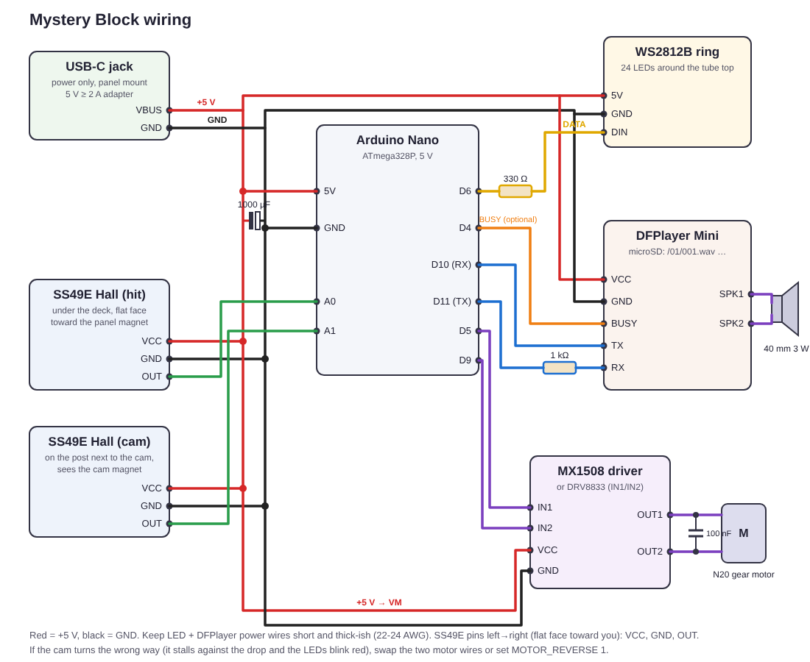

# Wiring

([SVG](images/wiring.svg), regenerate with `python tools/wiring_diagram.py`)

| From | To | Notes |
|---|---|---|
| USB-C jack VBUS | +5 V rail | 22 AWG if you have it |
| USB-C jack GND | GND rail | |
| 1000 µF capacitor | across +5 V / GND | close to the LED ring wires. Mind polarity |
| Nano 5V | +5 V rail | powering through the 5V pin bypasses the Nano's regulator (correct for a 5 V supply) |
| Nano GND | GND rail | |
| SS49E (hit) VCC / GND / OUT | +5 V / GND / **A0** | pins left→right with the printed face toward you |
| SS49E (cam) VCC / GND / OUT | +5 V / GND / **A1** | glued in the seat on the post next to the cam |
| MX1508 **VCC (VM)** / GND | +5 V / GND | the motor runs straight off the 5 V supply |
| Nano **D5** / **D9** | MX1508 **IN1** / **IN2** | channel A or B, either works |
| MX1508 **OUT1 / OUT2** | N20 motor | solder a **100 nF** ceramic across the motor tabs |
| Nano **D6** | 330 Ω → LED ring **DIN** | resistor near the ring |
| LED ring 5V / GND | +5 V / GND rails | |
| Nano **D10** (RX) | DFPlayer **TX** | |
| Nano **D11** (TX) | 1 kΩ → DFPlayer **RX** | the resistor removes a nasty buzz |
| Nano **D4** | DFPlayer **BUSY** | optional, unused by default firmware |
| DFPlayer VCC / GND | +5 V / GND | |
| DFPlayer **SPK1 / SPK2** | speaker | direct, no amp needed (built-in 3 W) |

**Tips**

* Build it on the bench first, flash and test, *then* install.
* Use plugs (JST-XH or Dupont) for the ring, Hall sensor and USB-C jack, so the
  walls and hopper can come off without desoldering.
* Check the motor direction on the bench before closing the block: send `f` in the
  Serial Monitor. If the cam pushes into its drop face and stalls (LEDs blink
  red after 3 s), swap the two motor wires or set `MOTOR_REVERSE 1`.
* Don't power the LEDs at full white from USB: `LED_BRIGHTNESS` defaults to 80/255.
* Unplug the block's USB-C supply before connecting the Nano's own USB port to
  a computer for programming. Two 5 V supplies fighting each other is the one
  way to damage things here.
